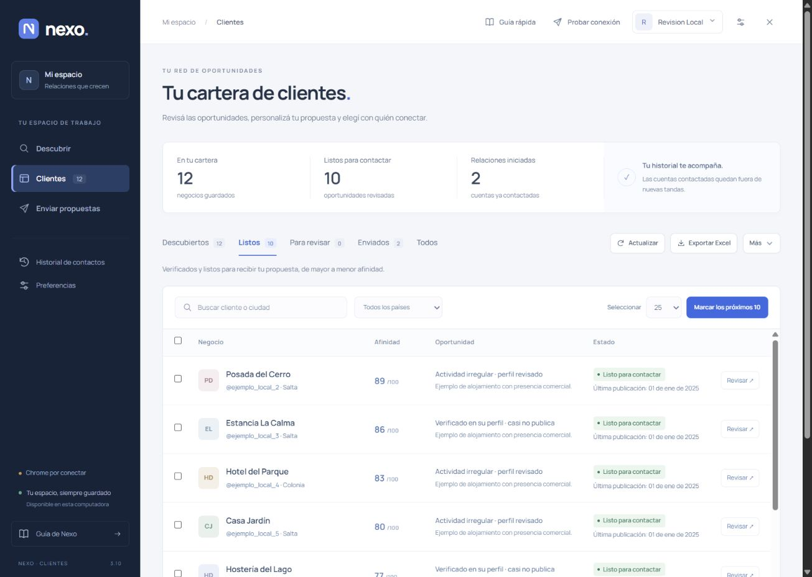

# Nexo · Clientes 3.11.0

Buscá negocios para tu oferta, revisá sus perfiles y prepará propuestas. Los envíos
trabajan en segundo plano para que puedas seguir usando la computadora.

## Descargar y empezar (Windows)

1. Descargá [Nexo para Windows x64](https://github.com/EnriqueArielLopez/nexo/releases/download/v3.11.0/Nexo-Windows-portable.zip).
   También está en la [última versión](https://github.com/EnriqueArielLopez/nexo/releases/latest).
2. Extraé todo el ZIP en una carpeta fija y abrí **Nexo.exe**.
3. Creá tu cuenta local. Para buscar, completá tu Instagram, oferta y filtros.
4. Para enviar por Instagram, seguí **Conectar mi Chrome** dentro de Nexo.
   Cada persona conecta su propio Chrome e Instagram. Para email, configurá su
   propia casilla en Ajustes.

Windows 10/11 x64, Edge e Internet; Chrome para enviar por navegador. El paquete
incluye Node y sus licencias. No necesitás instalar Node, Python, Excel ni Claude.
El ejecutable aún no tiene firma digital. El archivo `.sha256` permite comprobar
la descarga con `Get-FileHash -Algorithm SHA256`.



*Vista de ejemplo con datos ficticios.*

## Seguridad de 3.11

Refuerza acceso local, contraseñas, archivos importados, SMTP, consultas de red y
permisos de la extensión. El conector de Claude puede investigar y preparar;
los envíos de email y su programación se confirman desde Nexo. El conector ya no
abre credenciales y exige elegir un espacio cuando hay varios.

Leé [Seguridad](SECURITY.md), [Datos y uso responsable](PRIVACIDAD.md) y
[Validación de 3.11](docs/VALIDACION-3.11.md). El programa reduce riesgos técnicos;
no certifica cumplimiento legal ni garantiza ausencia de incidentes.

## Funciones de la aplicación

- **No repetir contactos:** además del historial de Nexo, comprueba si el chat del
  destinatario ya tiene mensajes, aunque el texto anterior sea diferente o sea
  una foto. Guarda la detección en **Enviados** como **Conversación previa**.
  Desde entonces la excluye localmente, incluso después de reiniciar, cambiar la
  propuesta o limpiar resultados. No consume el cupo de hoy ni inventa un envío.
- **Verificación acotada:** no recorre toda la bandeja. Solo abre el chat de cada
  destinatario desconocido, separa la conversación del listado lateral y espera
  que termine de cargar. Si no puede comprobar el destinatario o la carga, lo
  omite con un motivo visible. Reutiliza actividad del perfil de las últimas 24 h.
- **Chrome en segundo plano:** la extensión 1.3 crea la ventana ya minimizada y
  recupera la emulación de foco cuando se reconecta. Los errores pausan o se
  informan en Nexo; no traen Chrome al frente. El login sí requiere intervención.
- **Nuevo escritorio:** identidad visual propia, navegación lateral, tipografía
  Manrope incluida y cartera con resumen, filtros y estados claros. El editor
  separa la información del negocio de la propuesta. La navegación se adapta
  a ventanas pequeñas.
- **Propuestas que se conservan:** editar y guardar un mensaje ya no se pierde al
  preparar una tanda. Las propuestas personalizadas se respetan por Instagram y
  email, incluso al cambiar el mensaje base. Los respaldos conservan conversaciones
  previas, envíos inciertos y borradores.
- **Guía actualizada:** los pasos Descubrir, Clientes y Enviar propuestas coinciden
  con el programa; no hay un recorrido automático que interrumpa el primer ingreso.
- **Progreso claro:** muestra enviados, omitidos y pendientes, incluyendo fallos
  que detienen la tanda. El registro distingue un envío nuevo de un chat previo.

La búsqueda pública depende del índice, la red y sus verificaciones humanas; no
se garantiza un número de resultados ni un tiempo fijo. No se resuelven CAPTCHA.
Se mantienen revisión de destinatarios/textos, cupos, bajas, control de duplicados
y pausa ante envíos inciertos. La API oficial de Instagram sigue siendo opcional
con sus requisitos propios; ver [INSTAGRAM-OFICIAL.md](INSTAGRAM-OFICIAL.md).

## Actualizar y compartir

Descargá un respaldo desde Mi espacio y cerrá Nexo desde la bandeja. Extraé la
versión nueva en otra carpeta y abrí su Nexo.exe. Los datos de la instalación
Windows se conservan en `%LOCALAPPDATA%\NexoClientes\Datos`.
Después, **recargá la extensión de Nexo** en `chrome://extensions` para que use
el código actualizado. No instales una segunda copia de la extensión. Volvé a ejecutar
`Conectar-con-Claude.cmd` para registrar el espacio elegido si usás ese conector.
Después de iniciar sesión en 3.11, el hash se actualiza: no uses versiones
anteriores para operar esa misma base.

Compartí el ZIP de Releases; nunca tu carpeta Datos o la extensión ya configurada.
Cada persona crea su cuenta local y sus conexiones. No hay sincronización en nube:
la PC debe seguir encendida. [EMPEZA-ACA.txt](EMPEZA-ACA.txt) contiene la guía completa.

## Desarrollar y verificar

Node >=22.13, recomendado 24 LTS. Sin dependencias npm externas:

```powershell
npm test
$env:PORT='18779'
$env:HOTEL_DATA_DIR=Join-Path (Get-Location) 'qa/datos-aislados'
npm start
```

Abrí la URL `http://nexo-….localhost:18779` indicada al iniciar. La UI usa un
dominio privado de esta instalación para aislar sus cookies de otras apps locales. `HOTEL_DATA_DIR` aísla los datos del
servidor; `NEXO_DATA_DIR` sirve para QA del ejecutable. El puerto normal es 18761;
la extensión distribuida usa ese puerto. No usar datos/credenciales reales en QA.

Para compilar un portable nuevo (el destino no debe existir):

```powershell
powershell -File build-portable.ps1 -OutputDirectory dist/Nexo
```

Se puede elegir otro runtime con `-NodePath` y su licencia con `-NodeLicensePath`.
El ZIP no incluye bases, cuentas, sesiones, tokens, perfiles ni archivos de QA.
La [plantilla de CI para Windows](docs/validate-workflow.example.yml) ejecuta las
pruebas y verifica el lanzador. La [plantilla CodeQL](docs/security-workflow.example.yml)
prepara el análisis de JavaScript en cambios y semanalmente. Está preparada para copiarla a
`.github/workflows/validate.yml` desde una sesión con permiso `workflow`; el acceso
actual permite publicar código y releases, pero no activar workflows.
Los reportes privados de vulnerabilidades, el análisis de secretos y la
protección contra subir credenciales sí están activos.

Nexo es independiente del catálogo de aplicaciones de Practical Solutions. No
se instala en sus servidores Development/Producción. La validación del escritorio
se hace en Local y con un portable aislado; no equivale a probar esos ambientes.

[Validación y límites de 3.10](docs/VALIDACION-3.10.md) ·
[Arquitectura y operación](docs/ARQUITECTURA.md) ·
[Historial anterior](docs/HISTORIAL-3.8.md)
